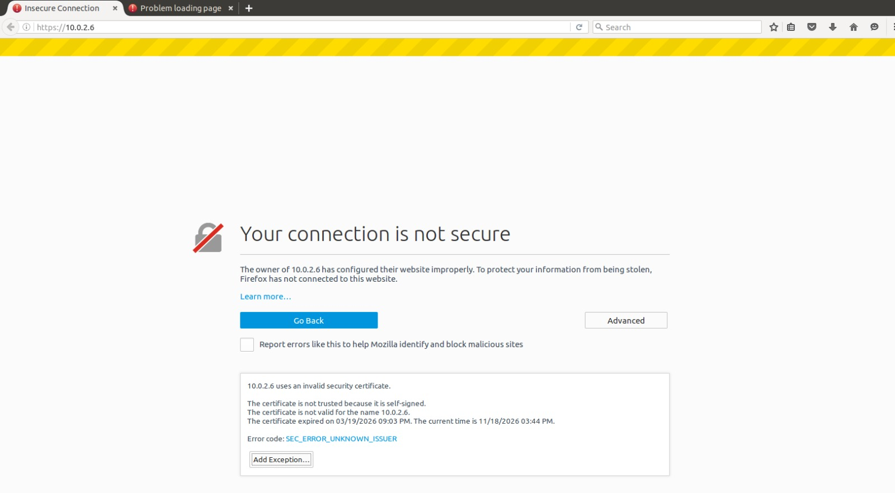
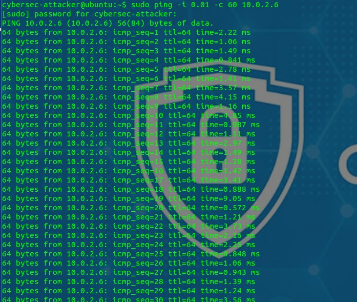
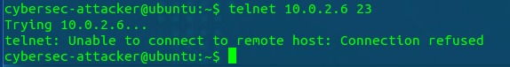
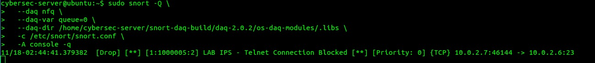
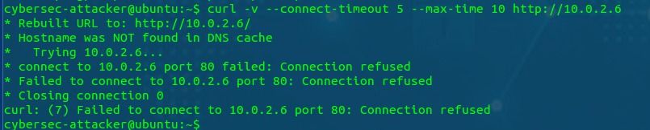
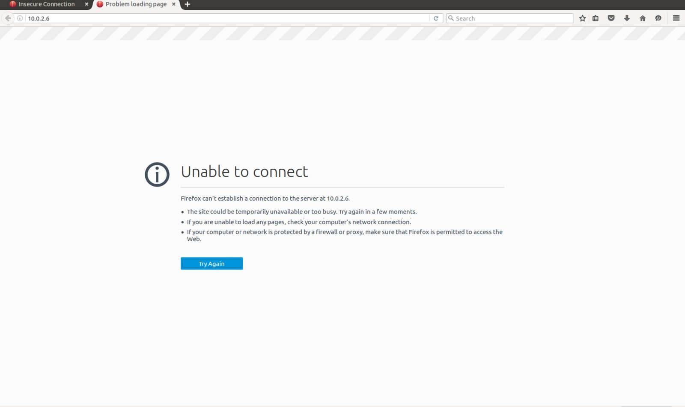
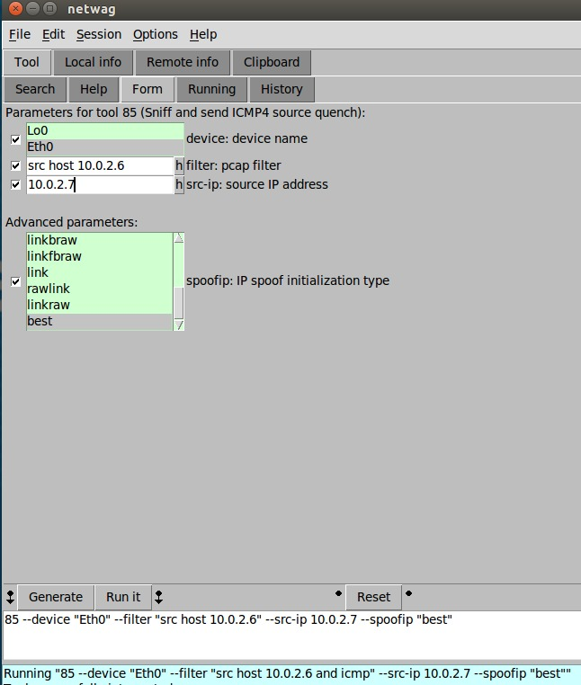

# Snort-IDS-IPS-Network-Security-Lab
A hands-on network security lab demonstrating intrusion detection and prevention using Snort 2.9.6, custom security rules, Linux NFQUEUE and two Ubuntu virtual machines.

## Network Architecture

The lab consists of two Ubuntu virtual machines connected through an isolated virtual network.


### Attacker VM — 10.0.2.7

The attacker VM generates controlled network traffic targeting the protected server, including SSH and Telnet connection attempts, HTTP/HTTPS requests and ICMP-based traffic.

### Server VM — 10.0.2.6

The protected server hosts the network services and Snort IDS/IPS engine.

Incoming traffic from the attacker is forwarded through Linux iptables to NFQUEUE 0, allowing Snort to inspect packets against the custom signatures defined in `local.rules`.

Depending on the matching rule, Snort either:

- **Generates an alert:** The traffic is logged and permitted.
- **Drops the packet:** The traffic is prevented from reaching the destination service and a drop event is generated.

This arrangement allows Snort to operate as an inline IPS without requiring a separate security appliance or additional virtual machine.


## Snort Configuration and Inline IPS

Snort was configured using custom security signatures stored in:

`/etc/snort/rules/local.rules`

The configuration includes both `alert` and `drop` rules, allowing different actions to be applied according to the network traffic being inspected.

### Enabling Inline Intrusion Prevention

Initially, Snort operated in passive IDS mode, detecting packets without preventing their delivery.

To enable active packet prevention, the NFQUEUE DAQ module was compiled for the existing Snort 2.9.6 installation and integrated with Linux iptables.

iptables was configured to queue incoming traffic originating from the attacker VM:

```bash
sudo iptables -I INPUT 1 \
  -s 10.0.2.7 \
  -d 10.0.2.6 \
  -j NFQUEUE --queue-num 0 --queue-bypass
```

The `NFQUEUE` target forwards matching packets to queue 0 for Snort inspection, rather than independently blocking them.

Snort was then executed in inline mode:

```bash
sudo snort -Q \
  --daq nfq \
  --daq-var queue=0 \
  --daq-dir /home/cybersec-server/snort-daq-build/daq-2.0.2/os-daq-modules/.libs \
  -c /etc/snort/snort.conf \
  -A console
```

The `-Q` parameter enables inline operation, while `--daq nfq` selects the NFQUEUE packet acquisition module.

This configuration allows Snort to apply the custom `drop` rules, preventing matching packets from reaching the protected server.

The `--queue-bypass` option permits traffic when no process is attached to the queue. It was used to reduce the risk of interrupting connectivity during lab testing.

### Custom Rules

All seven custom detection and prevention signatures are available in:

[View local.rules](rules/local.rules)

[local rules](screenshots/rules.png)


## Intrusion Detection System (IDS)

The IDS component focuses on identifying and logging network activity without unnecessarily interrupting legitimate communications.

Four detection scenarios were implemented using custom Snort `alert` rules.

### Scenario 1 — SSH Connection Detection (TCP 22)

**Objective:** Detect SSH connection attempts while permitting legitimate remote administration.

SSH is commonly used for secure remote administration because it encrypts communication between clients and servers.

Unlike Telnet, SSH protects authentication credentials and session contents against passive interception.

For this reason, the lab's security policy permits SSH connections while monitoring connection attempts for security visibility.

**Custom rule:**

```snort
alert tcp 10.0.2.7 any -> 10.0.2.6 22 (msg:"LAB IDS - SSH Connection Attempt Detected"; flags:S; sid:1000004; rev:2;)
```

**Attacker command:**

```bash
ssh cybersec-server@10.0.2.6
```

**Result:** The attacker VM successfully established an authenticated SSH session, while Snort generated an alert identifying the connection attempt.

The rule detects the TCP SYN connection attempt rather than determining whether the SSH authentication itself succeeded.

**Evidence:**


---

### Scenario 2 — HTTPS Connection Detection (TCP 443)

**Objective:** Detect HTTPS connection attempts while permitting encrypted web communication.

HTTPS uses TLS to encrypt web communications, providing confidentiality and integrity for data exchanged between a browser and web server.

The lab's policy permits HTTPS traffic while recording connection attempts through Snort.

**Custom rule:**

```snort
alert tcp 10.0.2.7 any -> 10.0.2.6 443 (msg:"LAB IDS - HTTPS Connection Attempt Detected"; flags:S; sid:1000006; rev:1;)
```

**Attacker command:**

```bash
curl -vk https://10.0.2.6
```

**Result:** The attacker VM successfully established a TLS connection and received an Apache HTTP response. Snort generated a corresponding HTTPS connection alert.

The server returned an HTTP 404 response for the requested path, indicating that the HTTPS connection was established but the requested resource was unavailable.

The lab also used a self-signed certificate that was expired and did not match the requested IP address. Firefox therefore displayed a certificate warning, while curl's `-k` option bypassed certificate verification for testing purposes.

This certificate warning was unrelated to Snort's IDS operation.

**Evidence:**




---

### Scenario 3 — ICMP Echo Request Detection

**Objective:** Detect ICMP Echo Requests while maintaining normal network connectivity.

ICMP Echo Requests are commonly used by administrators to verify connectivity and troubleshoot network issues.

Because ICMP is useful for legitimate network diagnostics, the lab's security policy monitors ordinary Echo Requests instead of blocking them.

**Custom rule:**

```snort
alert icmp 10.0.2.7 any -> 10.0.2.6 any (msg:"LAB IDS - ICMP Echo Request Detected"; itype:8; sid:1000001; rev:2;)
```

**Attacker command:**

```bash
ping -c 4 10.0.2.6
```

**Result:** Snort successfully generated alerts for ICMP Echo Requests originating from the attacker VM.

**Evidence:**


---

### Scenario 4 — ICMP Echo Flood Detection

**Objective:** Detect excessive ICMP Echo Requests using rate-based traffic analysis.

While ordinary ICMP traffic is useful for network troubleshooting, an unusually high volume of Echo Requests may indicate network scanning, flooding or denial-of-service activity.

A threshold-based rule was implemented to detect ICMP traffic exceeding 20 requests within one second.

**Custom rule:**

```snort
alert icmp 10.0.2.7 any -> 10.0.2.6 any (msg:"LAB IDS - ICMP Echo Flood Detected"; itype:8; detection_filter:track by_src,count 20,seconds 1; sid:1000007; rev:1;)
```

**Attacker command:**

```bash
sudo ping -i 0.01 -c 60 10.0.2.6
```

**Result:** Snort successfully detected the controlled high-frequency ICMP traffic and generated repeated threshold-based alerts.

The rule was configured for detection only and did not automatically block or rate-limit the traffic.

**Evidence:**




## Intrusion Prevention System (IPS)

The IPS component extends Snort's monitoring capabilities by actively preventing network traffic that violates the lab's security policy.

Three prevention scenarios were implemented using custom Snort `drop` rules.

Unlike passive IDS operation, inline IPS processing allows Snort to issue packet-drop decisions through the NFQUEUE interface.

### Scenario 5 — Telnet Connection Prevention (TCP 23)

**Objective:** Prevent insecure remote access using Telnet.

Telnet is an older remote administration protocol that transmits authentication credentials and session data without encryption.

This creates opportunities for credential interception and unauthorised disclosure if the traffic is captured by an attacker.

SSH provides encrypted remote administration and is therefore the preferred alternative.

For these reasons, the lab's security policy permits SSH while blocking Telnet.

**Custom rule:**

```snort
drop tcp 10.0.2.7 any -> 10.0.2.6 23 (msg:"LAB IPS - Telnet Connection Blocked"; sid:1000005; rev:2;)
```

**Attacker command:**

```bash
telnet 10.0.2.6 23
```

**Result:** Before inline IPS enforcement, the attacker successfully connected to the Telnet service and reached the Ubuntu login prompt.

After enabling Snort's inline prevention configuration, the Telnet connection was refused and Snort generated a matching `[Drop]` event.

This demonstrated that the insecure remote administration protocol was prevented while SSH remained permitted.

**Evidence:**

Telnet connection prevented:



Snort drop event:



---

### Scenario 6 — HTTP Connection Prevention (TCP 80)

**Objective:** Prevent unencrypted HTTP access while permitting HTTPS.

HTTP transmits application traffic without transport-layer encryption, potentially exposing sensitive information to interception.

HTTPS uses TLS to provide encrypted communications and is generally preferred for modern web applications.

The lab implements a strict policy that blocks HTTP connections while permitting HTTPS access.

This is a deliberately restrictive demonstration policy; some production environments still require HTTP for redirects, compatibility or specialised services.

**Custom rule:**

```snort
drop tcp 10.0.2.7 any -> 10.0.2.6 80 (msg:"LAB IPS - HTTP Connection Blocked"; sid:1000002; rev:2;)
```

**Attacker command:**

```bash
curl -v --connect-timeout 5 --max-time 10 http://10.0.2.6
```

**Result:** Before enabling inline prevention, Apache returned `HTTP/1.1 200 OK` and successfully delivered the HTTP login page.

After enabling the Snort IPS configuration, HTTP connection attempts failed and Snort generated corresponding `[Drop]` events.

An additional Firefox test demonstrated that the HTTP webpage could no longer be accessed.

**Evidence:**

HTTP connection prevented:





Snort drop event:


---

### Scenario 7 — ICMP Source Quench Prevention

**Objective:** Detect and prevent obsolete ICMP Source Quench traffic.

ICMP Source Quench (Type 4, Code 0) was historically used to request that a sender reduce its transmission rate during congestion.

The message type has since been deprecated because of security and protocol reliability concerns.

To demonstrate protocol-level intrusion prevention, a custom rule was configured to drop ICMP Source Quench packets.

**Custom rule:**

```snort
drop icmp 10.0.2.7 any -> 10.0.2.6 any (msg:"LAB IPS - ICMP Source Quench Blocked"; itype:4; icode:0; sid:1000003; rev:2;)
```

**Traffic generation:**

Netwox Tool 85, *Sniff and send ICMP4 source quench*, was used on the attacker VM to generate Source Quench traffic in response to captured packets.

**Result:** Snort successfully identified Source Quench packets originating from `10.0.2.7` and generated repeated `[Drop]` events.

This demonstrated active packet prevention using the custom ICMP security signature.

**Evidence:**




## Results Summary

All seven scenarios produced the expected Snort detection or prevention events.

| Scenario | Protocol | Snort Action | Outcome |
|---|---|---|---|
| SSH Connection | TCP 22 | Alert | Connection permitted and detected |
| HTTPS Connection | TCP 443 | Alert | TLS connection permitted and detected |
| ICMP Echo Request | ICMP Type 8 | Alert | Echo Requests detected |
| ICMP Echo Flood | ICMP Type 8 | Alert | Traffic-rate threshold detected |
| Telnet Connection | TCP 23 | Drop | Connection prevented |
| HTTP Connection | TCP 80 | Drop | Connection prevented |
| ICMP Source Quench | ICMP Type 4 | Drop | Packets discarded |

The experiments demonstrated that Snort can enforce different security policies depending on the characteristics and intended use of network traffic.

Importantly, legitimate SSH and HTTPS connections were permitted while insecure or prohibited Telnet and HTTP connections were blocked.

Normal ICMP Echo Requests were monitored, while excessive ICMP traffic triggered threshold-based detection. Obsolete ICMP Source Quench packets were actively dropped.

## Challenges and Troubleshooting

One of the main technical challenges involved extending the original Snort installation from passive intrusion detection to active intrusion prevention.

The installed DAQ library did not initially provide NFQUEUE support. To address this limitation, the required dependencies were installed and DAQ 2.0.2 was compiled with NFQUEUE enabled.

Snort was subsequently configured to operate in inline mode, while iptables redirected selected incoming packets to NFQUEUE 0.

Additional testing was conducted to verify that traffic was reaching Snort and that custom rules generated the expected alerts and drop events.

This process reinforced the distinction between simply detecting suspicious packets and configuring a system capable of actively preventing their delivery.

## Key Takeaways

This project provided practical experience in:

- Writing and testing custom Snort detection and prevention rules.
- Understanding differences between IDS and IPS operation.
- Configuring inline packet inspection using Linux NFQUEUE and iptables.
- Monitoring legitimate network protocols while preventing insecure or prohibited traffic.
- Detecting high-frequency ICMP traffic using threshold-based rules.
- Generating network traffic and interpreting security alerts.
- Troubleshooting security tool configurations and validating packet-drop behaviour.

Overall, this lab demonstrated how Snort can support a layered network security strategy by combining traffic visibility with selective intrusion prevention.

## Author

**Ali Fares**

Bachelor of Cybersecurity — University of Technology Sydney (UTS)

This project extends an earlier UTS Cybersecurity practical through additional custom rules, protocol testing and inline Snort IPS implementation.

## References

## References

Fielding, R., Nottingham, M., & Reschke, J. (2022). *HTTP semantics* (RFC 9110). RFC Editor. https://doi.org/10.17487/RFC9110

Gont, F. (2012). *Deprecation of ICMP Source Quench messages* (RFC 6633). RFC Editor. https://doi.org/10.17487/RFC6633

Postel, J. (1981). *Internet Control Message Protocol* (RFC 792). RFC Editor. https://doi.org/10.17487/RFC792

Postel, J., & Reynolds, J. (1983). *Telnet protocol specification* (RFC 854). RFC Editor. https://doi.org/10.17487/RFC854

Snort. (n.d.-a). *README.daq*. https://www.snort.org/document/readme-daq

Snort. (n.d.-b). *README.filters*. https://www.snort.org/document/readme-filters

Ylonen, T., & Lonvick, C. (2006). *The Secure Shell (SSH) protocol architecture* (RFC 4251). RFC Editor. https://doi.org/10.17487/RFC4251
