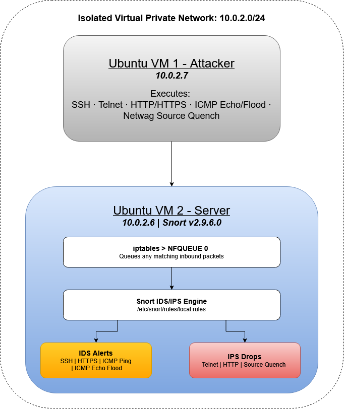

# Snort-IDS-IPS-Network-Security-Lab
A hands-on network security lab demonstrating intrusion detection and prevention using Snort 2.9.6, custom security rules, Linux NFQUEUE and two Ubuntu virtual machines.

## Network Architecture

The lab consists of two Ubuntu virtual machines connected through an isolated virtual network.



### Attacker VM — 10.0.2.7

The attacker VM generates controlled network traffic targeting the protected server, including SSH and Telnet connection attempts, HTTP/HTTPS requests and ICMP-based traffic.

### Server VM — 10.0.2.6

The protected server hosts the network services and Snort IDS/IPS engine.

Incoming traffic from the attacker is forwarded through Linux iptables to NFQUEUE 0, allowing Snort to inspect packets against the custom signatures defined in `local.rules`.

Depending on the matching rule, Snort either:

- **Generates an alert:** The traffic is logged and permitted.
- **Drops the packet:** The traffic is prevented from reaching the destination service and a drop event is generated.

This arrangement allows Snort to operate as an inline IPS without requiring a separate security appliance or additional virtual machine.


## Snort Configuration and Inline IPS

Snort was configured using custom security signatures stored in:

`/etc/snort/rules/local.rules`

The configuration includes both `alert` and `drop` rules, allowing different actions to be applied according to the network traffic being inspected.

### Enabling Inline Intrusion Prevention

Initially, Snort operated in passive IDS mode, detecting packets without preventing their delivery.

To enable active packet prevention, the NFQUEUE DAQ module was compiled for the existing Snort 2.9.6 installation and integrated with Linux iptables.

iptables was configured to queue incoming traffic originating from the attacker VM:

```bash
sudo iptables -I INPUT 1 \
  -s 10.0.2.7 \
  -d 10.0.2.6 \
  -j NFQUEUE --queue-num 0 --queue-bypass
```

The `NFQUEUE` target forwards matching packets to queue 0 for Snort inspection, rather than independently blocking them.

Snort was then executed in inline mode:

```bash
sudo snort -Q \
  --daq nfq \
  --daq-var queue=0 \
  --daq-dir /home/cybersec-server/snort-daq-build/daq-2.0.2/os-daq-modules/.libs \
  -c /etc/snort/snort.conf \
  -A console
```

The `-Q` parameter enables inline operation, while `--daq nfq` selects the NFQUEUE packet acquisition module.

This configuration allows Snort to apply the custom `drop` rules, preventing matching packets from reaching the protected server.

The `--queue-bypass` option permits traffic when no process is attached to the queue. It was used to reduce the risk of interrupting connectivity during lab testing.

### Custom Rules

All seven custom detection and prevention signatures are available in:

[View local.rules](rules/local.rules)

[View local.rules](screenshots/rules.png)
