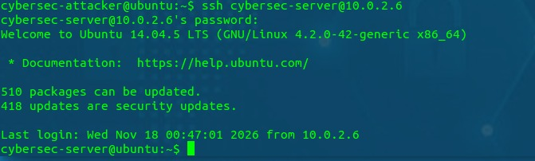
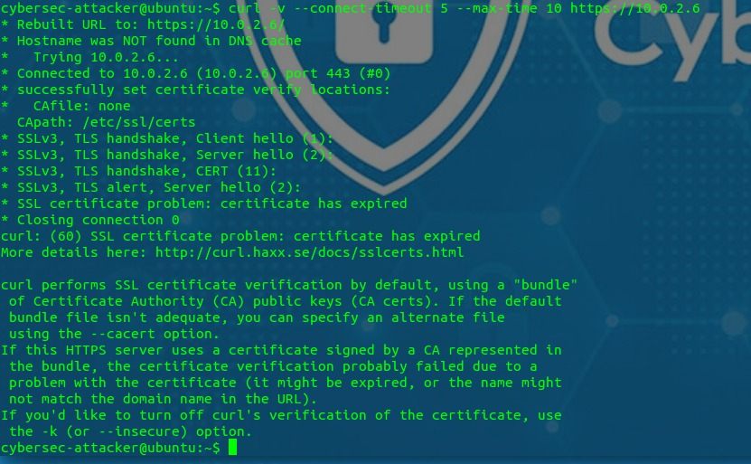
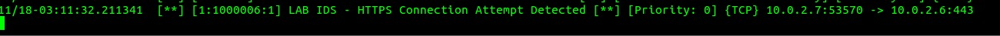
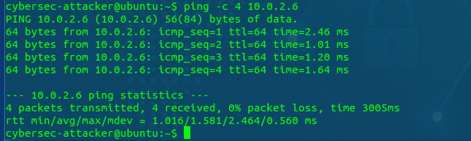
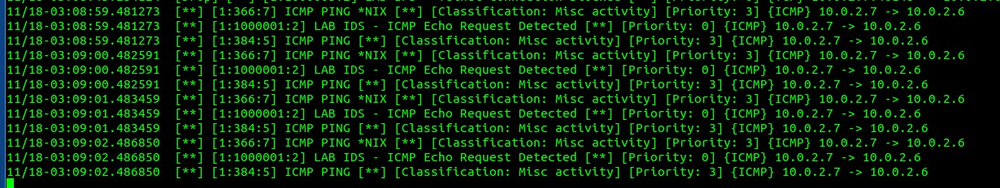
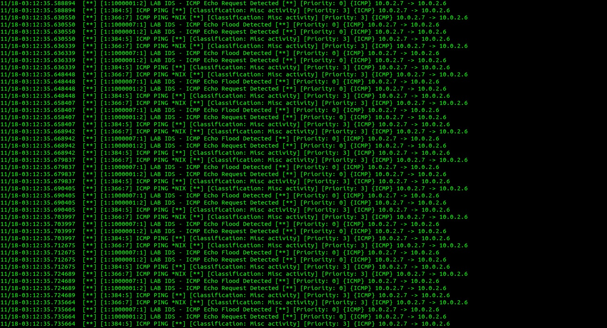

# Snort-IDS-IPS-Network-Security-Lab
A hands-on network security lab demonstrating intrusion detection and prevention using Snort 2.9.6, custom security rules, Linux NFQUEUE and two Ubuntu virtual machines.

## Network Architecture

The lab consists of two Ubuntu virtual machines connected through an isolated virtual network.


### Attacker VM — 10.0.2.7

The attacker VM generates controlled network traffic targeting the protected server, including SSH and Telnet connection attempts, HTTP/HTTPS requests and ICMP-based traffic.

### Server VM — 10.0.2.6

The protected server hosts the network services and Snort IDS/IPS engine.

Incoming traffic from the attacker is forwarded through Linux iptables to NFQUEUE 0, allowing Snort to inspect packets against the custom signatures defined in `local.rules`.

Depending on the matching rule, Snort either:

- **Generates an alert:** The traffic is logged and permitted.
- **Drops the packet:** The traffic is prevented from reaching the destination service and a drop event is generated.

This arrangement allows Snort to operate as an inline IPS without requiring a separate security appliance or additional virtual machine.


## Snort Configuration and Inline IPS

Snort was configured using custom security signatures stored in:

`/etc/snort/rules/local.rules`

The configuration includes both `alert` and `drop` rules, allowing different actions to be applied according to the network traffic being inspected.

### Enabling Inline Intrusion Prevention

Initially, Snort operated in passive IDS mode, detecting packets without preventing their delivery.

To enable active packet prevention, the NFQUEUE DAQ module was compiled for the existing Snort 2.9.6 installation and integrated with Linux iptables.

iptables was configured to queue incoming traffic originating from the attacker VM:

```bash
sudo iptables -I INPUT 1 \
  -s 10.0.2.7 \
  -d 10.0.2.6 \
  -j NFQUEUE --queue-num 0 --queue-bypass
```

The `NFQUEUE` target forwards matching packets to queue 0 for Snort inspection, rather than independently blocking them.

Snort was then executed in inline mode:

```bash
sudo snort -Q \
  --daq nfq \
  --daq-var queue=0 \
  --daq-dir /home/cybersec-server/snort-daq-build/daq-2.0.2/os-daq-modules/.libs \
  -c /etc/snort/snort.conf \
  -A console
```

The `-Q` parameter enables inline operation, while `--daq nfq` selects the NFQUEUE packet acquisition module.

This configuration allows Snort to apply the custom `drop` rules, preventing matching packets from reaching the protected server.

The `--queue-bypass` option permits traffic when no process is attached to the queue. It was used to reduce the risk of interrupting connectivity during lab testing.

### Custom Rules

All seven custom detection and prevention signatures are available in:

[View local.rules](rules/local.rules)

[local rules](screenshots/rules.png)


## Intrusion Detection System (IDS)

The IDS component focuses on identifying and logging network activity without unnecessarily interrupting legitimate communications.

Four detection scenarios were implemented using custom Snort `alert` rules.

### Scenario 1 — SSH Connection Detection (TCP 22)

**Objective:** Detect SSH connection attempts while permitting legitimate remote administration.

SSH is commonly used for secure remote administration because it encrypts communication between clients and servers.

Unlike Telnet, SSH protects authentication credentials and session contents against passive interception.

For this reason, the lab's security policy permits SSH connections while monitoring connection attempts for security visibility.

**Custom rule:**

```snort
alert tcp 10.0.2.7 any -> 10.0.2.6 22 (msg:"LAB IDS - SSH Connection Attempt Detected"; flags:S; sid:1000004; rev:2;)
```

**Attacker command:**

```bash
ssh cybersec-server@10.0.2.6
```

**Result:** The attacker VM successfully established an authenticated SSH session, while Snort generated an alert identifying the connection attempt.

The rule detects the TCP SYN connection attempt rather than determining whether the SSH authentication itself succeeded.

**Evidence:**




---

### Scenario 2 — HTTPS Connection Detection (TCP 443)

**Objective:** Detect HTTPS connection attempts while permitting encrypted web communication.

HTTPS uses TLS to encrypt web communications, providing confidentiality and integrity for data exchanged between a browser and web server.

The lab's policy permits HTTPS traffic while recording connection attempts through Snort.

**Custom rule:**

```snort
alert tcp 10.0.2.7 any -> 10.0.2.6 443 (msg:"LAB IDS - HTTPS Connection Attempt Detected"; flags:S; sid:1000006; rev:1;)
```

**Attacker command:**

```bash
curl -vk https://10.0.2.6
```

**Result:** The attacker VM successfully established a TLS connection and received an Apache HTTP response. Snort generated a corresponding HTTPS connection alert.

The server returned an HTTP 404 response for the requested path, indicating that the HTTPS connection was established but the requested resource was unavailable.

The lab also used a self-signed certificate that was expired and did not match the requested IP address. Firefox therefore displayed a certificate warning, while curl's `-k` option bypassed certificate verification for testing purposes.

This certificate warning was unrelated to Snort's IDS operation.

**Evidence:**






---

### Scenario 3 — ICMP Echo Request Detection

**Objective:** Detect ICMP Echo Requests while maintaining normal network connectivity.

ICMP Echo Requests are commonly used by administrators to verify connectivity and troubleshoot network issues.

Because ICMP is useful for legitimate network diagnostics, the lab's security policy monitors ordinary Echo Requests instead of blocking them.

**Custom rule:**

```snort
alert icmp 10.0.2.7 any -> 10.0.2.6 any (msg:"LAB IDS - ICMP Echo Request Detected"; itype:8; sid:1000001; rev:2;)
```

**Attacker command:**

```bash
ping -c 4 10.0.2.6
```

**Result:** Snort successfully generated alerts for ICMP Echo Requests originating from the attacker VM.

**Evidence:**





---

### Scenario 4 — ICMP Echo Flood Detection

**Objective:** Detect excessive ICMP Echo Requests using rate-based traffic analysis.

While ordinary ICMP traffic is useful for network troubleshooting, an unusually high volume of Echo Requests may indicate network scanning, flooding or denial-of-service activity.

A threshold-based rule was implemented to detect ICMP traffic exceeding 20 requests within one second.

**Custom rule:**

```snort
alert icmp 10.0.2.7 any -> 10.0.2.6 any (msg:"LAB IDS - ICMP Echo Flood Detected"; itype:8; detection_filter:track by_src,count 20,seconds 1; sid:1000007; rev:1;)
```

**Attacker command:**

```bash
sudo ping -i 0.01 -c 60 10.0.2.6
```

**Result:** Snort successfully detected the controlled high-frequency ICMP traffic and generated repeated threshold-based alerts.

The rule was configured for detection only and did not automatically block or rate-limit the traffic.

**Evidence:**




